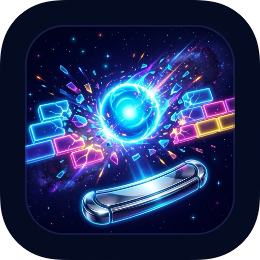
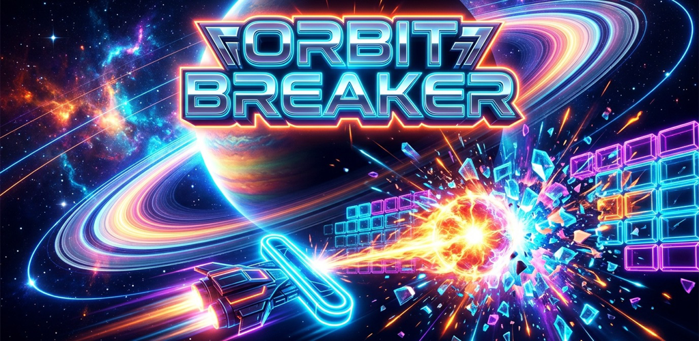

# Orbit Breaker 🪐⚡

<div align="center">



### *High-Octane 3D Cyber-Cosmic Brick Breaker for Mobile*

[](https://reactnative.dev/)
[](https://expo.dev/)
[](https://threejs.org/)
[](https://www.typescriptlang.org/)
[](./src/__tests__/runTests.ts)
[](https://play.google.com/store)
[](./LICENSE)

<br/>



</div>

---

## 📖 Overview

**Orbit Breaker** is a modern, high-framerate 3D arcade brick-breaker built natively for mobile devices with **React Native**, **Expo**, and **Three.js** (via `expo-gl`). 

Departing from conventional 2D flat arcade clones, Orbit Breaker immerses players in the deep void of space with full 3D dynamic lighting, specular cube materials, physics-driven particle cascades, and responsive gesture-based touch physics. Set across 50 handcrafted planetary sectors and an infinite procedural endgame, players navigate deep celestial rifts using skill, reflexes, and the signature **Precision Curve Strike** mechanic.

---

## 🎮 Key Features & Gameplay Mechanics

### 🌀 1. Precision Curve Strike (Magnus Effect)
- **Fluid Spin Physics**: Swipe the paddle sideways at the exact millisecond of impact to impart rotational spin to the sphere.
- **Trajectory Bending**: The ball curves along parabolic arcs in real time, enabling advanced trick shots behind unbreakable defensive barricades and snaking through dense brick clusters.

### 🌌 2. 50 Cosmic Sectors & Endless Mode
- **Journey Across the Galaxy**: Battle through 50 escalating sectors spanning planetary orbits from *Saturn Rings*, *Pegasus Prime*, *Andromeda Sector*, and *Europa Rift* to the dangerous *Solar Core*.
- **Procedural Endless Mode**: Reaching Sector 50+ activates the infinite procedural level synthesizer, generating infinitely varied brick density, randomized power-ups, and speed scaling.
- **Sector Replay System**: Revisit any previously conquered sector at will to beat personal best scores and earn credits without risking sector progression.

### 🧱 3. Tactical Brick Archetypes
Every sector features a deliberate mix of interactive 3D voxel bricks:
- 🔵 **Normal Bricks**: Core energy bricks shattered with a single clean hit.
- 🛡️ **Armored Bricks**: Multi-hit reinforced barriers that crack visually as their hit points deplete.
- 💥 **Explosive Bricks**: Detonates adjacent bricks in a localized area-of-effect shockwave (capped per sector for fair tactical balance).
- ⚡ **Speed Bricks**: Accelerates the projectile upon deflection for high-velocity challenge.
- ⬛ **Unbreakable Obstacles**: Indestructible celestial alloy blocks requiring precise angle calculation and bank shots.
- 🎁 **Power-Up Bricks**: Drops collectible tactical modules upon destruction.

### ⚡ 4. Tactical Perks & Power-Ups
- **Wide Paddle**: Extends the magnetic deflection surface, giving superior ball control.
- **Multi-Ball**: Splits the projectile into multiple high-energy spheres to overwhelm clusters.
- **Energy Shield**: Deploys an emergency laser barrier across the bottom hazard zone, rescuing fallen spheres.

### 🔥 5. Dynamic Speed & Endgame Tension
- **Combo Acceleration**: Ball speed begins at `0.12` units/frame and ramps smoothly up to `0.18` as combos climb.
- **Sudden-Death Final 10**: When fewer than 10 bricks remain on the battlefield, the game enters endgame overdrive—elevating speed directly to `0.20` for a thrilling climax.

### 🎨 6. "Neon Midnight" Cyber-Cosmic Visuals
- Deep obsidian base (`#0B1020`), vibrant cyan (`#22D3EE`), ultraviolet (`#8B5CF6`), and neon pink (`#F472B6`) accents.
- Rotating collection of minimalist celestial space wallpapers (*Saturn Rings*, *Orbital Eclipse*, *Celestial Horizon*, *Orbital Rings*, *Distant Cosmos*) that rotate seamlessly between sectors without repeating.

### 🔊 7. Synthesizer Audio & Haptic Feedback
- **Built-in Procedural Audio**: Real-time synthesized laser ricochets, explosive blasts, shield hums, and UI feedback without heavyweight external sound bundles.
- **Native Haptic Engine**: Tactile impact impulses integrated via `expo-haptics`.

---
## 🏗️ Architecture & Project Structure

The project adheres to clean modular React Native patterns, decoupling 3D rendering loops, game state engines, audio synthesis, and persistent storage:

```
neon-rift/
├── App.tsx                     # Main application entry, screen state & game coordinator
├── app.json                    # Expo configuration, bundle IDs, icons, plugins & ProGuard rules
├── eas.json                    # Expo Application Services (EAS) cloud build profiles
├── package.json                # Project dependencies and script definitions
├── tsconfig.json               # TypeScript compiler options
│
├── assets/                     # Graphic resources, backgrounds, icons & store art
│   ├── wallpapers/             # Dark minimalist celestial wallpapers
│   └── playstore/              # High-resolution screenshots and marketing graphics
│
└── src/
    ├── audio/
    │   └── soundManager.ts     # Synthesizer audio engine (synthesized laser & impact cues)
    │
    ├── components/
    │   ├── GameCanvas.tsx      # Core 3D engine: Three.js scene, camera, shaders & touch handlers
    │   ├── HUDOverlay.tsx      # In-game heads-up display: score, lives, combo meter, sound toggle
    │   ├── MenuOverlay.tsx      # Sector selector grid, how-to-play modal & high-score display
    │   ├── GameOverModal.tsx   # Game over summary, retry prompt & session rewards
    │   ├── VictoryModal.tsx    # Sector cleared modal, stars & next sector progression
    │   ├── RewardedContinueModal.tsx # Emergency continue modal for rewarded revives
    │   └── PerkSVGIcon.tsx     # Vector icon rendering for active tactical perks
    │
    ├── config/
    │   ├── ads.ts              # Ad frequency thresholds, capped lives, and placement IDs
    │   ├── features.ts         # Feature flags (Precision Curve Strike toggle)
    │   ├── theme.ts            # Neon Midnight color tokens & typography presets
    │   └── wallpapers.ts       # Rotating space background resolver & deduplication logic
    │
    ├── game/
    │   └── levels.ts           # Handcrafted layouts for Sectors 1-50 + endless generator
    │
    ├── types/
    │   └── game.ts             # TypeScript definitions for Brick, Ball, Paddle, PowerUp, etc.
    │
    ├── utils/
    │   ├── adManager.ts        # Google AdMob lifecycle wrapper with mock failsafe mode
    │   └── storage.ts          # AsyncStorage wrapper for persistent level progression & scores
    │
    └── __tests__/
        └── runTests.ts         # Comprehensive headless TypeScript test suite (28 test specs)
```

---

## 🛠️ Technology Stack

| Layer | Technology | Details |
| :--- | :--- | :--- |
| **Framework** | [React Native](https://reactnative.dev/) `0.86.3` | Mobile app core platform |
| **Ecosystem** | [Expo](https://expo.dev/) `~57.0.27` | Native runtime, Continuous Native Generation (CNG) |
| **3D Rendering** | [Three.js](https://threejs.org/) `^0.160.0` + [`expo-gl`](https://docs.expo.dev/versions/latest/sdk/gl-view/) | Real-time WebGL rendering pipeline |
| **Language** | [TypeScript](https://www.typescriptlang.org/) `~6.0.3` | Strict type checking & zero type errors |
| **Typography** | [Google Fonts](https://fonts.google.com/) | `@expo-google-fonts/orbitron` & `rajdhani` |
| **Gesture Controls** | React Native `PanResponder` | Ultra-low latency paddle deflection tracking |
| **Haptics** | `expo-haptics` | Device vibration and tactile feedback |
| **Persistence** | `@react-native-async-storage/async-storage` | High scores, unlocked sectors, credits & sound preferences |
| **Advertising** | `react-native-google-mobile-ads` | Rewarded extra life continue & interstitial ads |

---

## 🚀 Getting Started

### Prerequisites

- **Node.js**: `v18.0.0` or higher
- **Package Manager**: `npm` (or `bun` / `yarn`)
- **Mobile Development**:
  - [Android Studio](https://developer.android.com/studio) & Android SDK (API 34+) for Android builds
  - [Xcode](https://developer.apple.com/xcode/) (macOS only) for iOS builds
  - [Expo Go](https://expo.dev/go) app on your physical mobile device for rapid testing

### Installation

1. **Clone the repository:**
   ```bash
   git clone https://github.com/your-username/neon-rift.git
   cd neon-rift
   ```

2. **Install dependencies:**
   ```bash
   npm install
   ```

3. **Verify type checking and tests:**
   ```bash
   npm test
   npx tsc --noEmit
   ```

---

## 📱 Running the Application

### 1. Development Server (Metro)
Start the Expo Metro bundler:
```bash
npm start
```
Scan the displayed QR code with **Expo Go** (Android) or the Camera app (iOS) to load the project on your device.

### 2. Native Android Run
Build and run directly on a connected Android device or emulator:
```bash
npm run android
```

### 3. Native iOS Run (macOS only)
Build and run on an iOS simulator or connected iPhone:
```bash
npm run ios
```

---

## 🧪 Testing & Validation

The project includes an automated test suite verifying level generation bounds, explosive brick caps, theme palette constants, DNS ad-block resilience, session keying, ball speed escalation, and progress preservation:

```bash
npm test
```

### Test Suite Highlights:
- ✅ **Level Generator**: Validates brick bounds, color definitions, and explosive brick safety limits (max 2 per level) across all 50 sectors.
- ✅ **Procedural Generator**: Validates infinite level generation for Sectors 50+.
- ✅ **Theme Integrity**: Enforces strict conformance to the Neon Midnight design tokens.
- ✅ **Ad Monetization Safeguards**: Enforces rewarded continue caps (max 2 continues per game), frequency rules (1 interstitial per 3 games), and DNS blocker / AdGuard reject security.
- ✅ **Progress Protection**: Confirms replaying lower sectors preserves higher sector unlocks and high scores.
- ✅ **Endgame Speed Curve**: Guarantees consistent speed curves (0.12 base acceleration up to 0.18, and sudden-death overdrive to 0.20 for the final 10 bricks).

---

## 📦 Building for Production

### Cloud Builds via EAS (Expo Application Services)

1. **Install EAS CLI:**
   ```bash
   npm install -g eas-cli
   ```

2. **Log in to Expo:**
   ```bash
   eas login
   ```

3. **Build Android APK (Preview/Internal Distribution):**
   ```bash
   eas build --platform android --profile preview
   ```

4. **Build Android Production Bundle (Google Play AAB):**
   ```bash
   eas build --platform android --profile production
   ```

### Android Native Optimization & ProGuard Rules
Orbit Breaker uses Android R8 minification and resource shrinking for peak performance. Custom ProGuard rules in `app.json` protect the JNI bridges required by `expo-gl` and Google Mobile Ads:
```pro
-keep class expo.modules.gl.** { *; }
-keep interface expo.modules.gl.** { *; }
-keepclasseswithmembernames class * { native <methods>; }
-keep class com.facebook.react.turbomodule.** { *; }
-keep class com.facebook.react.bridge.** { *; }
-keep class com.google.android.gms.ads.** { *; }
-keep class com.google.ads.** { *; }
```

---

## 🔒 Privacy & Compliance

- **No Personal Accounts**: Orbit Breaker requires no user registration, sign-in, or passwords.
- **Local Gameplay Data**: All scores, unlocked sectors, collected coins, and audio settings reside entirely on the local device via AsyncStorage.
- **COPPA & GDPR Compliant**: Configured to respect user consent and tracking parameters.
- For full legal disclosures, read the complete.

---

## 📄 License

This project is licensed under the **MIT License**. See the [LICENSE](./LICENSE) file for complete details.

---

<div align="center">
  <sub>Developed by <b>Kinchit Jikar</b></sub>
</div>
